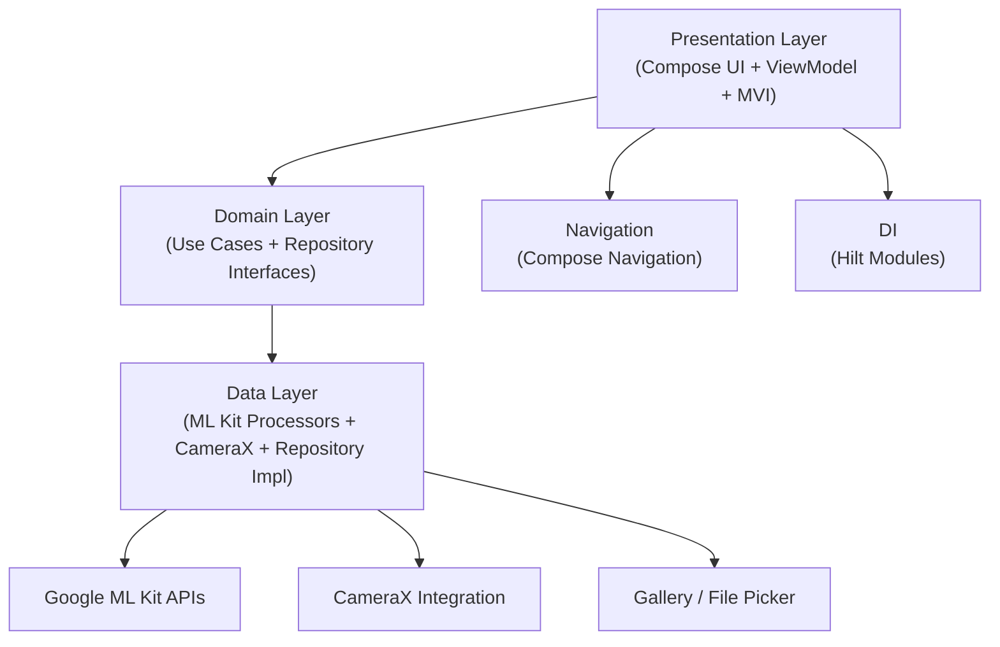
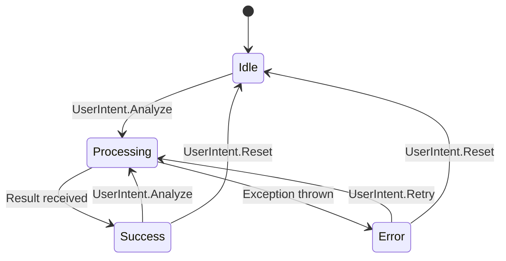

# 🧠 SmartVision AI — ML Kit Playground: Master Implementation Plan

> [!IMPORTANT]
> **Goal**: Build a production-grade Android app integrating **all major Google ML Kit APIs** while mastering the internal workings, real-world use cases, and interview-ready knowledge for **Android Tech Lead / Senior Engineer** roles.

---

## 📋 Project Overview

| Property | Value |
|---|---|
| **App Name** | SmartVision AI – ML Kit Playground |
| **Package** | `android.ai.smartvisionaimlkitplayground` |
| **Min SDK** | 24 |
| **Target SDK** | 37 |
| **AGP** | 9.5.2 |
| **Kotlin** | 2.2.10 |
| **Compose BOM** | 2026.02.01 |

### Technology Stack

| Layer | Technology |
|---|---|
| Language | Kotlin |
| UI | Jetpack Compose + Material 3 |
| Architecture | Clean Architecture + MVI |
| Async | Kotlin Coroutines + StateFlow |
| DI | Hilt |
| Camera | CameraX |
| ML | Google ML Kit (on-device) |
| Build | Gradle Kotlin DSL + Version Catalog |
| Testing | JUnit + Compose Testing |

---

## 🏗️ Architecture Design



### MVI Pattern Per Feature



### Package Structure

```
android.ai.smartvisionaimlkitplayground/
├── SmartVisionApp.kt                    # @HiltAndroidApp
├── MainActivity.kt                      # Single Activity
├── navigation/
│   └── AppNavGraph.kt                   # Navigation graph
├── core/
│   ├── camera/                          # CameraX setup + ImageAnalysis
│   ├── permissions/                     # Runtime permissions
│   ├── utils/                           # Extensions, helpers
│   └── ui/                              # Shared Compose components
├── feature/
│   ├── home/                            # Dashboard with all features
│   ├── textrecognition/                 # ML Kit: Text Recognition
│   │   ├── data/                        # Processor, Repository Impl
│   │   ├── domain/                      # Models, UseCase, Repository Interface
│   │   └── presentation/               # Screen, ViewModel, State, Intent
│   ├── barcodescanning/                 # ML Kit: Barcode Scanning
│   ├── facedetection/                   # ML Kit: Face Detection
│   ├── imagelabeling/                   # ML Kit: Image Labeling
│   ├── objectdetection/                 # ML Kit: Object Detection & Tracking
│   ├── posedetection/                   # ML Kit: Pose Detection
│   ├── selfiesegmentation/             # ML Kit: Selfie Segmentation
│   ├── languageid/                      # ML Kit: Language Identification
│   ├── translation/                     # ML Kit: On-Device Translation
│   ├── smartreply/                      # ML Kit: Smart Reply
│   ├── digitalinkrec/                   # ML Kit: Digital Ink Recognition
│   └── documentscanner/                # ML Kit: Document Scanner
└── di/
    └── modules/                         # Hilt modules per feature
```

---

## 🔄 Execution Phases (One-by-One)

> [!NOTE]
> Each phase is executed sequentially. After completing each phase, a detailed **Learning Document (.md)** is created containing:
> - ✅ What the API does & how it works internally
> - ✅ Implementation walkthrough with code
> - ✅ Real-world use cases & business applications
> - ✅ Top 10 interview questions with detailed answers

---

### Phase 0: Project Foundation & Infrastructure Setup
**Status**: 🟡 Pending  
**Estimated Effort**: Large — broken into **6 sub-phases** below  

> [!NOTE]
> Phase 0 is the backbone of the entire app. It has been split into 6 sequential sub-phases so each can be executed, reviewed, and tested independently before moving on.

---

#### Phase 0A: Version Catalog & Gradle Configuration
**Status**: 🟢 Completed  

**What Gets Built:**
1. Update `gradle/libs.versions.toml` with ALL dependencies (Hilt, KSP, CameraX, Navigation, Kotlin Serialization, Coil, all 15 ML Kit APIs)
2. Update root `build.gradle.kts` with Hilt + KSP + Serialization plugins
3. Update app `build.gradle.kts` — apply plugins, add all dependencies, enable KSP
4. Sync and verify project compiles cleanly

**Files Modified:**
- `gradle/libs.versions.toml`
- `build.gradle.kts` (root)
- `app/build.gradle.kts`
- `gradle.properties`

---

#### Phase 0B: Hilt DI & MVI Base Infrastructure
**Status**: 🟢 Completed  

**What Gets Built:**
1. `SmartVisionApp.kt` — `@HiltAndroidApp` Application class
2. Update `AndroidManifest.xml` with Application class
3. Update `MainActivity.kt` with `@AndroidEntryPoint`
4. MVI contracts — `UiState`, `UiIntent`, `UiEffect` marker interfaces
5. `BaseViewModel<S: UiState, I: UiIntent, E: UiEffect>` — reusable MVI ViewModel base
6. Result wrapper — `sealed class MlKitResult<T>` (Loading / Success / Error)

**Files Created:**
- `core/base/UiState.kt`, `UiIntent.kt`, `UiEffect.kt`
- `core/base/BaseViewModel.kt`
- `core/base/MlKitResult.kt`
- `SmartVisionApp.kt`

---

#### Phase 0C: Permission Handling System
**Status**: 🟡 Pending  

**What Gets Built:**
1. `PermissionManager` — Composable wrapper for runtime permissions (Camera, Storage, Microphone)
2. `PermissionState` — Sealed class for permission states (Granted / Denied / PermanentlyDenied)
3. `PermissionRationale` composable — Explains why each permission is needed
4. Settings redirect utility — Opens app settings when permanently denied
5. Multi-permission request support (e.g., Camera + Audio together)

**Files Created:**
- `core/permissions/PermissionManager.kt`
- `core/permissions/PermissionState.kt`
- `core/permissions/PermissionRationaleDialog.kt`
- `core/permissions/PermissionUtils.kt`

---

#### Phase 0D: CameraX Integration & Image Input Pipeline
**Status**: 🟡 Pending  

**What Gets Built:**
1. `CameraXManager` — Hilt-injectable CameraX lifecycle-aware manager
2. `CameraPreviewComposable` — Reusable `AndroidView` wrapping `PreviewView`
3. `ImageAnalyzerCallback` — Interface for ML Kit analyzers to plug into CameraX
4. `GalleryPicker` — Photo picker / gallery image loading utility
5. `ImageCaptureHelper` — Capture photo from camera to `Bitmap`
6. `BitmapUtils` — Rotation, scaling, `InputImage` conversion utilities
7. Camera lens toggle (front/back) support
8. Flash toggle support

**Files Created:**
- `core/camera/CameraXManager.kt`
- `core/camera/CameraPreviewComposable.kt`
- `core/camera/ImageAnalyzerCallback.kt`
- `core/camera/GalleryPicker.kt`
- `core/camera/ImageCaptureHelper.kt`
- `core/utils/BitmapUtils.kt`

---

#### Phase 0E: Core UI Components & Theme
**Status**: 🟡 Pending  

**What Gets Built:**
1. `FeatureCard` — Card composable for each ML Kit feature on the dashboard
2. `ResultOverlay` — Canvas overlay for drawing bounding boxes, landmarks, text on camera preview
3. `LoadingIndicator` — Animated loading state composable
4. `ErrorDisplay` — Reusable error state with retry action
5. `ImageSourceSelector` — Bottom sheet to choose Camera / Gallery / Capture
6. `AnalysisResultCard` — Card to display ML results (labels, confidence bars)
7. Theme polish — Colors, typography updates for ML Kit app branding
8. App icons and feature icons setup

**Files Created:**
- `core/ui/FeatureCard.kt`
- `core/ui/ResultOverlay.kt`
- `core/ui/LoadingIndicator.kt`
- `core/ui/ErrorDisplay.kt`
- `core/ui/ImageSourceSelector.kt`
- `core/ui/AnalysisResultCard.kt`
- Updated `ui/theme/Color.kt`, `Theme.kt`, `Type.kt`

---

#### Phase 0F: Navigation & Home Dashboard
**Status**: 🟡 Pending  

**What Gets Built:**
1. `AppNavGraph.kt` — Type-safe Compose Navigation with `@Serializable` routes for all 15 features
2. `Route.kt` — Sealed interface with all route definitions
3. `HomeScreen.kt` — Dashboard grid showing all ML Kit features with icons, descriptions, and navigation
4. `HomeViewModel.kt` — MVI ViewModel for the home screen (feature list state)
5. `HomeContract.kt` — State, Intent, Effect for home screen
6. Wire up `MainActivity` → `AppNavGraph` → `HomeScreen`
7. Placeholder screens for each feature (navigable but showing "Coming Soon")

**Files Created:**
- `navigation/Route.kt`
- `navigation/AppNavGraph.kt`
- `feature/home/HomeScreen.kt`
- `feature/home/HomeViewModel.kt`
- `feature/home/HomeContract.kt`
- `feature/home/model/FeatureItem.kt`

---

#### Phase 0 Deliverable (after all sub-phases):
- 📄 `Phase_00_Project_Foundation.md` — Architecture decisions, CameraX internals, MVI pattern deep dive, Hilt setup, permission handling, and 10 interview questions

---

### Phase 1: Text Recognition (OCR)
**Status**: 🟡 Pending  
**ML Kit API**: `com.google.mlkit:text-recognition` + `text-recognition-chinese` + `text-recognition-devanagari` + `text-recognition-japanese` + `text-recognition-korean`  

#### What the API Does:
Recognizes and extracts text from images, supporting Latin, Chinese, Devanagari, Japanese, and Korean scripts. Returns structured results with blocks → lines → elements hierarchy including bounding boxes, confidence scores, and recognized languages.

#### What Gets Built:
1. Text Recognition processor using `TextRecognizer`
2. Camera live-feed OCR with real-time text overlay
3. Gallery image text extraction
4. Multi-language script support selector
5. Copy-to-clipboard functionality for extracted text
6. Bounding box overlay visualization on detected text

#### Real-World Use Cases:
- Document digitization & archiving
- Business card scanning → auto-populate contacts
- Receipt/invoice scanning for expense tracking
- License plate recognition (parking systems)
- Prescription reading for healthcare apps
- Translating text from photos (travel apps)

#### Deliverable:
- 📄 `Phase_01_Text_Recognition.md` — API internals, implementation, use cases, top 10 interview Q&A

---

### Phase 2: Barcode Scanning
**Status**: 🟡 Pending  
**ML Kit API**: `com.google.mlkit:barcode-scanning`

#### What the API Does:
Scans and decodes 1D barcodes (Code 128, Code 39, Code 93, Codabar, EAN-8, EAN-13, ITF, UPC-A, UPC-E) and 2D barcodes (QR Code, Data Matrix, PDF417, Aztec). Extracts structured data like URLs, Wi-Fi credentials, contacts, calendar events, geolocation, etc.

#### What Gets Built:
1. Barcode scanner processor using `BarcodeScanner`
2. Real-time camera scanning with auto-detection
3. Support for all barcode formats (selectable)
4. Structured data parsing (URL, Wi-Fi, Contact, Email, Phone, Geo, Calendar)
5. Action buttons per data type (open URL, connect Wi-Fi, save contact)
6. Scan history with Room database

#### Real-World Use Cases:
- Retail: Product lookup / price comparison
- Payments: UPI QR code scanning
- Event management: Ticket validation
- Warehouse: Inventory tracking
- Healthcare: Patient wristband scanning
- Wi-Fi: One-scan network joining

#### Deliverable:
- 📄 `Phase_02_Barcode_Scanning.md` — API internals, implementation, use cases, top 10 interview Q&A

---

### Phase 3: Face Detection
**Status**: 🟡 Pending  
**ML Kit API**: `com.google.mlkit:face-detection`

#### What the API Does:
Detects faces in images/video frames, identifies facial landmarks (eyes, nose, mouth, ears, cheeks), classifies facial expressions (smiling probability, eyes-open probability), detects face contours (133 points), and supports face tracking across frames.

#### What Gets Built:
1. Face Detection processor using `FaceDetector`
2. Real-time face detection with camera preview
3. Facial landmark overlay drawing (Canvas)
4. Expression analysis display (smile %, eyes open %)
5. Face contour visualization
6. Face count display
7. Performance mode toggle (Fast vs Accurate)

#### Real-World Use Cases:
- Authentication: Face-based app unlock
- Photography: Auto-focus on faces, smile-to-capture
- Social media: Face filters and AR effects base
- Attendance systems: Employee face check-in
- Driver monitoring: Drowsiness detection (eyes closed)
- Retail analytics: Customer emotion analysis

#### Deliverable:
- 📄 `Phase_03_Face_Detection.md` — API internals, implementation, use cases, top 10 interview Q&A

---

### Phase 4: Image Labeling
**Status**: 🟡 Pending  
**ML Kit API**: `com.google.mlkit:image-labeling`

#### What the API Does:
Identifies entities in images — objects, locations, activities, animal species, products — returning labels with confidence scores. The base model recognizes 400+ labels. Can also use custom TFLite models for domain-specific labeling.

#### What Gets Built:
1. Image Labeling processor using `ImageLabeler`
2. Real-time camera-feed labeling
3. Gallery image labeling
4. Confidence threshold slider
5. Label results list with confidence bars
6. Custom model support structure (AutoML / TFLite)

#### Real-World Use Cases:
- E-commerce: Auto-tagging product images for search
- Photo organization: Smart albums by content
- Accessibility: Describing images for visually impaired
- Content moderation: Flagging inappropriate images
- Agriculture: Crop/plant disease identification
- Insurance: Damage assessment from photos

#### Deliverable:
- 📄 `Phase_04_Image_Labeling.md` — API internals, implementation, use cases, top 10 interview Q&A

---

### Phase 5: Object Detection & Tracking
**Status**: 🟡 Pending  
**ML Kit API**: `com.google.mlkit:object-detection`

#### What the API Does:
Detects and tracks up to 5 objects in real time, providing bounding boxes, tracking IDs, and coarse classification (Fashion, Food, Home Goods, Places, Plants). Supports both single-image and streaming (live camera) modes.

#### What Gets Built:
1. Object Detection processor using `ObjectDetector`
2. Real-time multi-object tracking with bounding boxes
3. Object classification display
4. Tracking ID persistence visualization
5. Single vs Multiple object mode toggle
6. Classification enable/disable toggle
7. Custom model integration point

#### Real-World Use Cases:
- Retail: Visual product search (point camera → find product)
- Autonomous systems: Obstacle detection
- Warehousing: Package counting & tracking
- Augmented Reality: Object anchoring
- Security: Surveillance object tracking
- Robotics: Pick-and-place guidance

#### Deliverable:
- 📄 `Phase_05_Object_Detection.md` — API internals, implementation, use cases, top 10 interview Q&A

---

### Phase 6: Pose Detection
**Status**: 🟡 Pending  
**ML Kit API**: `com.google.mlkit:pose-detection` + `pose-detection-accurate`

#### What the API Does:
Detects human body pose by locating 33 body landmarks (joints) in real time. Returns x, y, z coordinates and in-frame likelihood for each landmark. Supports both base (fast) and accurate models.

#### What Gets Built:
1. Pose Detection processor using `PoseDetector`
2. Real-time skeleton overlay on camera preview
3. Joint point visualization with connections
4. Landmark coordinate display
5. In-frame confidence indicators
6. Base vs Accurate model toggle
7. Exercise rep counter (e.g., squat detection logic)

#### Real-World Use Cases:
- Fitness: Real-time exercise form correction
- Physical therapy: Recovery movement tracking
- Sports analytics: Athlete performance analysis
- Dance/yoga: Pose matching and scoring
- Ergonomics: Workplace posture monitoring
- Gaming: Body-controlled game input

#### Deliverable:
- 📄 `Phase_06_Pose_Detection.md` — API internals, implementation, use cases, top 10 interview Q&A

---

### Phase 7: Selfie Segmentation
**Status**: 🟡 Pending  
**ML Kit API**: `com.google.mlkit:segmentation-selfie`

#### What the API Does:
Segments person from background in images/video, generating a segmentation mask where each pixel has a confidence value indicating whether it belongs to the foreground (person) or background. Works in real time for selfie/portrait applications.

#### What Gets Built:
1. Selfie Segmentation processor using `Segmenter`
2. Real-time background blur effect
3. Background replacement with custom images
4. Background color replacement
5. Portrait mode effect
6. Mask visualization mode
7. Stream vs Single image mode toggle

#### Real-World Use Cases:
- Video calls: Virtual backgrounds (Zoom/Meet-style)
- Photography: Professional portrait mode
- E-commerce: Product try-on with clean backgrounds
- Social media: Creative selfie effects
- Broadcasting: Green-screen-free background replacement
- Privacy: Face/body-aware redaction

#### Deliverable:
- 📄 `Phase_07_Selfie_Segmentation.md` — API internals, implementation, use cases, top 10 interview Q&A

---

### Phase 8: Language Identification
**Status**: 🟡 Pending  
**ML Kit API**: `com.google.mlkit:language-id`

#### What the API Does:
Identifies the language of a given text string. Returns BCP-47 language codes with confidence scores. Can identify a single most-likely language or return a list of possible languages with their confidence values. Supports 100+ languages.

#### What Gets Built:
1. Language ID processor using `LanguageIdentification`
2. Text input field with real-time language detection
3. Single language identification mode
4. Multiple possible languages list with confidence
5. Minimum confidence threshold control
6. Language code → human-readable name mapping
7. Sample text buttons for different languages

#### Real-World Use Cases:
- Multilingual apps: Auto-detect user's language
- Customer support: Route tickets by language
- Content platforms: Auto-categorize by language
- Translation apps: Pre-detect source language
- Spam filtering: Identify language of messages
- Social media: Language-based content feed

#### Deliverable:
- 📄 `Phase_08_Language_Identification.md` — API internals, implementation, use cases, top 10 interview Q&A

---

### Phase 9: On-Device Translation
**Status**: 🟡 Pending  
**ML Kit API**: `com.google.mlkit:translate`

#### What the API Does:
Translates text between 50+ languages entirely on-device. Downloads language models (~30 MB each) on demand. Works offline once models are downloaded. Provides model management APIs for downloading, checking availability, and deleting models.

#### What Gets Built:
1. Translation processor using `Translator`
2. Source and target language selection dropdowns
3. Real-time text translation
4. Model download management with progress
5. Available/downloaded models list
6. Offline translation capability display
7. Chain translation demo (Language A → B → C)
8. Combined with Language ID for auto-detect source

#### Real-World Use Cases:
- Travel apps: Real-time offline translation
- Messaging: Auto-translate incoming messages
- Education: Language learning assistance
- Healthcare: Patient communication across languages
- E-commerce: Product description localization
- Accessibility: Breaking language barriers

#### Deliverable:
- 📄 `Phase_09_Translation.md` — API internals, implementation, use cases, top 10 interview Q&A

---

### Phase 10: Smart Reply
**Status**: 🟡 Pending  
**ML Kit API**: `com.google.mlkit:smart-reply`

#### What the API Does:
Generates contextually relevant reply suggestions for conversations. Analyzes the conversation history and suggests up to 3 short responses. Works entirely on-device for privacy. Supports English language conversations.

#### What Gets Built:
1. Smart Reply processor using `SmartReplyGenerator`
2. Chat-style conversation UI
3. Dynamic reply suggestion chips
4. Conversation history management
5. Local user vs remote user message distinction
6. Suggestion confidence display
7. Demo conversations with pre-loaded history

#### Real-World Use Cases:
- Messaging apps: One-tap quick replies
- Customer support: Agent response suggestions
- Email: Quick response suggestions
- Social media: Comment reply suggestions
- Chatbots: Fallback human-like responses
- Accessibility: Faster communication for users with motor disabilities

#### Deliverable:
- 📄 `Phase_10_Smart_Reply.md` — API internals, implementation, use cases, top 10 interview Q&A

---

### Phase 11: Digital Ink Recognition
**Status**: 🟡 Pending  
**ML Kit API**: `com.google.mlkit:digital-ink-recognition`

#### What the API Does:
Recognizes handwritten text drawn on a digital surface (touchscreen). Takes stroke data (sequences of x, y, timestamp points) and converts them into text. Supports 300+ languages and emoji recognition. Can also recognize shapes and auto-draw.

#### What Gets Built:
1. Digital Ink processor using `DigitalInkRecognizer`
2. Drawing canvas composable with touch input handling
3. Stroke capture and management
4. Real-time handwriting-to-text conversion
5. Language/model selector and download manager
6. Clear canvas and undo functionality
7. Recognition result display with alternatives

#### Real-World Use Cases:
- Note-taking: Handwritten notes to searchable text
- Education: Digital worksheets and exams
- Banking: Signature capture and verification
- Accessibility: Handwriting input method for keyboards
- Creative apps: Shape recognition and auto-correction
- Form filling: Handwritten form digitization

#### Deliverable:
- 📄 `Phase_11_Digital_Ink_Recognition.md` — API internals, implementation, use cases, top 10 interview Q&A

---

### Phase 12: Document Scanner
**Status**: 🟡 Pending  
**ML Kit API**: `com.google.android.gms:play-services-mlkit-document-scanner`

#### What the API Does:
Provides a complete document scanning flow — automatic edge detection, perspective correction, shadow removal, and PDF/JPEG export. Leverages the Google Play Services ML Kit module for a pre-built, high-quality scanning experience with minimal code.

#### What Gets Built:
1. Document Scanner integration using `GmsDocumentScanner`
2. Single and multi-page document scanning
3. Automatic edge detection and crop
4. PDF export functionality
5. JPEG export with quality control
6. Gallery import mode
7. Scanned document viewer
8. Share/export scanned documents

#### Real-World Use Cases:
- Business: Expense receipt scanning
- Education: Textbook/notes digitization
- Legal: Contract/document archiving
- Healthcare: Medical record scanning
- Government: ID/passport document capture
- Real estate: Property document management

#### Deliverable:
- 📄 `Phase_12_Document_Scanner.md` — API internals, implementation, use cases, top 10 interview Q&A

---

### Phase 13: Face Mesh Detection
**Status**: 🟡 Pending  
**ML Kit API**: `com.google.mlkit:face-mesh-detection`

#### What the API Does:
Detects 468 3D face mesh points providing dense face geometry. Returns a full 3D mesh with triangle topology for detailed face surface reconstruction. Ideal for AR effects that need precise face surface mapping.

#### What Gets Built:
1. Face Mesh processor using `FaceMeshDetector`
2. Real-time 468-point mesh overlay
3. 3D mesh triangle visualization
4. Individual mesh point inspection
5. Mesh region highlighting (forehead, cheeks, etc.)
6. Comparison with Face Detection (landmark overlay)

#### Real-World Use Cases:
- AR filters: Precise face-fitted masks and effects
- Virtual try-on: Glasses, makeup, jewelry
- Gaming: Face-mapped avatars
- Healthcare: Facial symmetry analysis
- Animation: Real-time face motion capture
- Beauty apps: Skin analysis zone mapping

#### Deliverable:
- 📄 `Phase_13_Face_Mesh_Detection.md` — API internals, implementation, use cases, top 10 interview Q&A

---

### Phase 14: Entity Extraction
**Status**: 🟡 Pending  
**ML Kit API**: `com.google.mlkit:entity-extraction`

#### What the API Does:
Identifies and extracts structured entities from text — dates/times, addresses, phone numbers, email addresses, URLs, flight numbers, IBAN codes, ISBN numbers, money/currency, tracking numbers, and payment card numbers. Provides actionable results.

#### Real-World Use Cases:
- Messaging: Auto-detect dates → create calendar events
- Email: Extract flight details → show boarding pass
- CRM: Auto-populate contact fields from text
- Travel: Parse itinerary emails for trip details
- Finance: Extract transaction amounts and account numbers
- Logistics: Parse tracking numbers from messages

#### What Gets Built:
1. Entity Extraction processor using `EntityExtractor`
2. Text input with entity highlighting
3. Entity type filtering
4. Actionable entity results (tap date → calendar, tap phone → dial)
5. Model download management
6. Multi-language entity extraction

#### Deliverable:
- 📄 `Phase_14_Entity_Extraction.md` — API internals, implementation, use cases, top 10 interview Q&A

---

### Phase 15: Subject Segmentation
**Status**: 🟡 Pending  
**ML Kit API**: `com.google.android.gms:play-services-mlkit-subject-segmentation`

#### What the API Does:
Segments multiple foreground subjects (people, pets, objects) from the background in an image. Unlike selfie segmentation which only segments the primary person, subject segmentation can identify and separate multiple distinct subjects.

#### What Gets Built:
1. Subject Segmentation processor
2. Multi-subject mask visualization
3. Individual subject selection and isolation
4. Background removal for multiple subjects
5. Comparison with Selfie Segmentation
6. Subject count and area display

#### Real-World Use Cases:
- Photo editing: Remove background from product photos
- E-commerce: Auto-generate clean product images
- Social media: Multi-person background effects
- Video production: Real-time multi-subject compositing
- Education: Interactive image dissection
- Real estate: Room staging with virtual furniture

#### Deliverable:
- 📄 `Phase_15_Subject_Segmentation.md` — API internals, implementation, use cases, top 10 interview Q&A

---

### Phase 16: Polish, Testing & Interview Prep Compilation
**Status**: 🟡 Pending  

#### What Gets Built:
1. **Unit Tests** — JUnit tests for all processors and ViewModels
2. **UI Tests** — Compose testing for key screens
3. **Error Handling** — Comprehensive error states and recovery
4. **Performance Optimization** — Memory management, frame rate optimization
5. **UI Polish** — Animations, transitions, accessibility
6. **Master Interview Guide** — Consolidated Q&A document from all phases

#### Deliverable:
- 📄 `Phase_16_Testing_And_Interview_Master_Guide.md` — Complete testing strategy + consolidated 150+ interview Q&A

---

## 📊 Execution Summary

| Phase | Feature | ML Kit API | Input Type |
|-------|---------|------------|------------|
| **0A** | Version Catalog & Gradle | — | — |
| **0B** | Hilt DI & MVI Base | — | — |
| **0C** | Permission System | — | — |
| **0D** | CameraX & Image Pipeline | — | Camera + Gallery |
| **0E** | Core UI Components | — | — |
| **0F** | Navigation & Home Dashboard | — | — |
| **1** | Text Recognition | `text-recognition` | Camera + Gallery |
| **2** | Barcode Scanning | `barcode-scanning` | Camera + Gallery |
| **3** | Face Detection | `face-detection` | Camera + Gallery |
| **4** | Image Labeling | `image-labeling` | Camera + Gallery |
| **5** | Object Detection | `object-detection` | Camera (Streaming) |
| **6** | Pose Detection | `pose-detection` | Camera (Streaming) |
| **7** | Selfie Segmentation | `segmentation-selfie` | Camera (Streaming) |
| **8** | Language ID | `language-id` | Text Input |
| **9** | Translation | `translate` | Text Input |
| **10** | Smart Reply | `smart-reply` | Conversation Text |
| **11** | Digital Ink | `digital-ink-recognition` | Touch/Draw Input |
| **12** | Document Scanner | Play Services | Camera (Built-in UI) |
| **13** | Face Mesh | `face-mesh-detection` | Camera (Streaming) |
| **14** | Entity Extraction | `entity-extraction` | Text Input |
| **15** | Subject Segmentation | `segmentation-subject` | Camera + Gallery |
| **16** | Testing & Polish | — | — |
